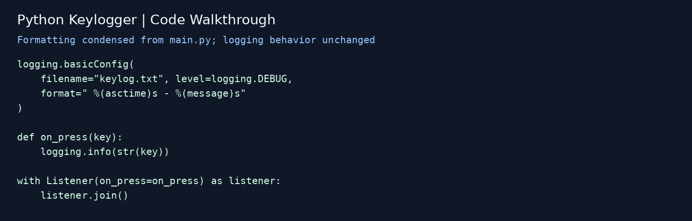
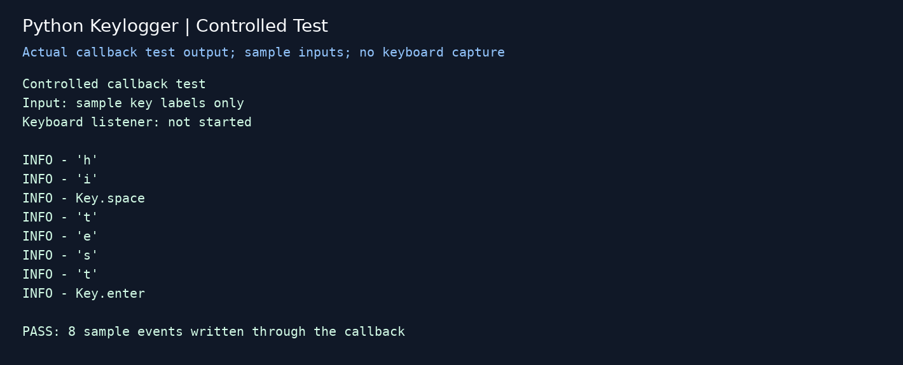

# Python Keylogger | Keyboard Event Logging Lab

An early Python cybersecurity lab that converts keyboard events into timestamped log records. The implementation follows a tutorial and maps event listeners to callback functions and local logging.

## What the Project Does

- Uses `pynput` to listen for keyboard events.
- Passes each pressed key to an `on_press` callback.
- Converts the key into text and sends it to Python’s logging system.
- Configures local output in `keylog.txt` with timestamps.

## Validated Behavior

| Area | Skill demonstrated |
| --- | --- |
| Python | Imports, functions, arguments, and string conversion |
| Event handling | Connecting a keyboard listener to a callback |
| Logging | Configuring a log destination, level, and timestamp format |
| Security understanding | Recognizing how keyboard input can become a local artifact |
| Troubleshooting | Correcting indentation and checking the callback independently |

## Visual Walkthrough

### 1. How the Code Is Connected

This code image condenses the formatting of [main.py](main.py). It captures the logging configuration, callback, and listener connection.

### 2. Controlled Test Result

This image renders actual test output from a controlled callback check. Eight sample key labels were passed through the project’s callback, including space and Enter. All eight produced the expected log entries. The test used an in-memory log and did not start the keyboard listener.

[Read the captured test output](docs/controlled-test-output.txt)

**Validation scope:** Python syntax and callback logging were checked during this portfolio update. Live keyboard capture and timestamped file output were not tested in this environment. These images document the current walkthrough and controlled test, rather than an original 2022 runtime session.

## Repository Guide

| Item | Purpose |
| --- | --- |
| [main.py](main.py) | Original tutorial-based implementation, with listener indentation corrected |
| [images](images) | Code walkthrough and controlled-test captures |
| [docs](docs) | Test output and validation context |

## Learning Context & Credit

This is a tutorial-based training project, based on [AskPython’s Python keylogger tutorial](https://www.askpython.com/python/examples/python-keylogger). It documents event-driven Python behavior and the artifacts produced by keyboard logging. Any live testing belongs on a device I own or have permission to test.

[Cybersecurity labs](https://github.com/ronisha609/CyberSecurity) · [Intelligence portfolio](https://app.notion.com/p/3cd81644420380669bf8e68cab6082bf)
